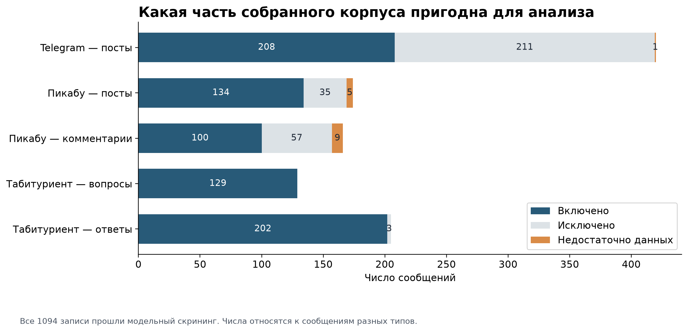
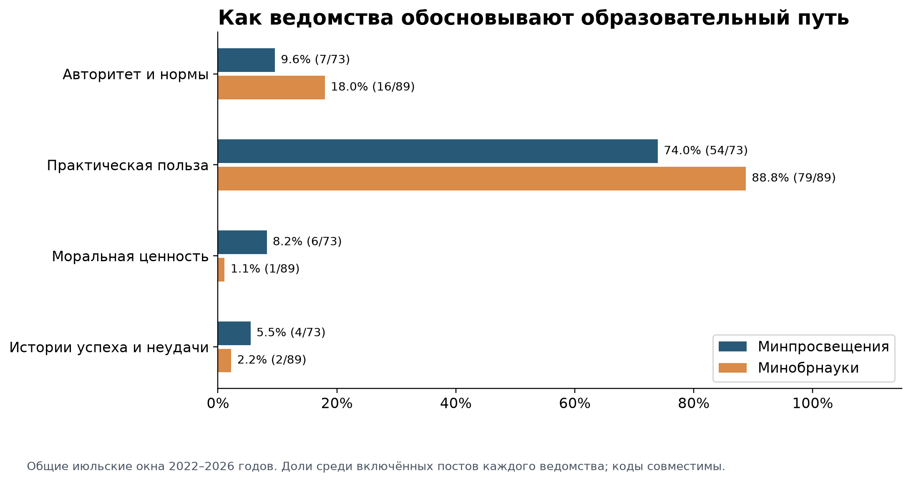
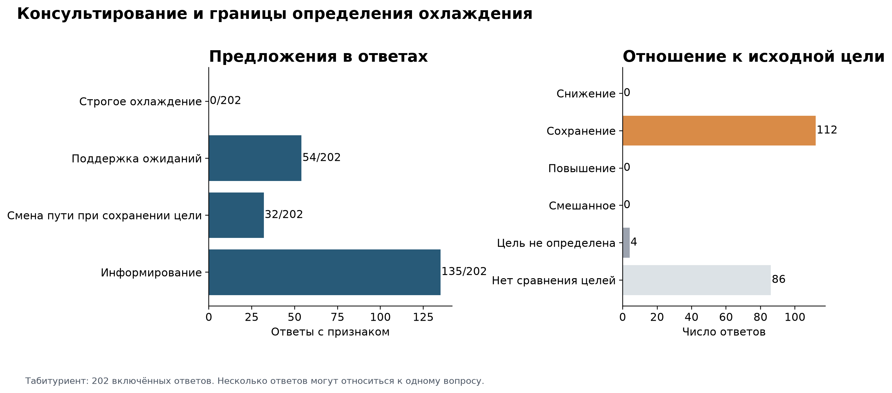
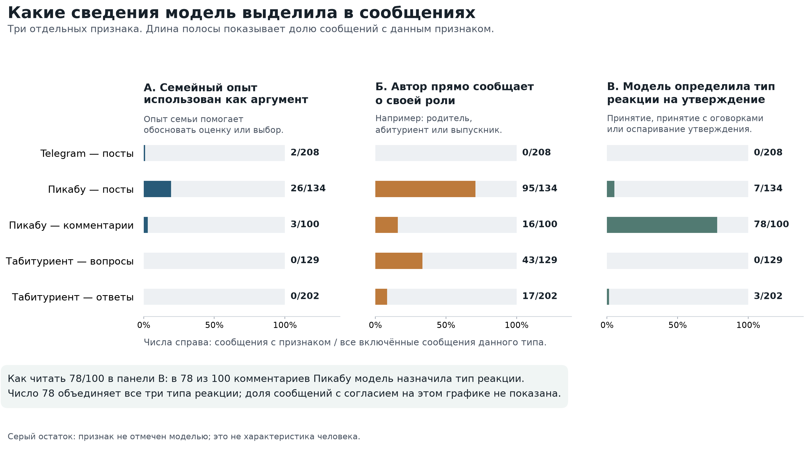
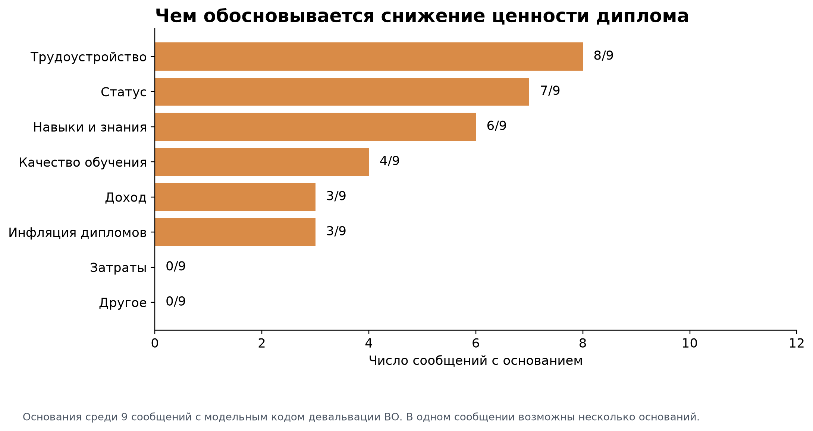
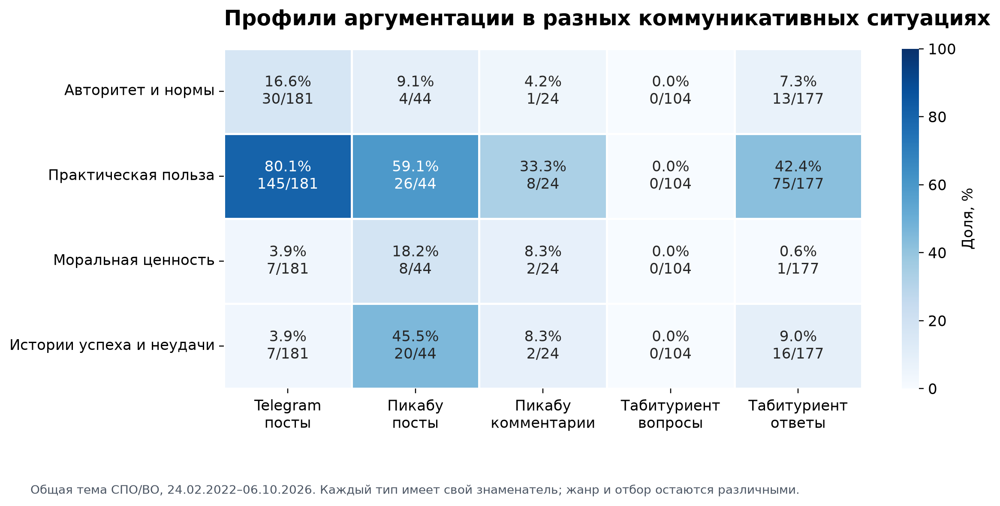
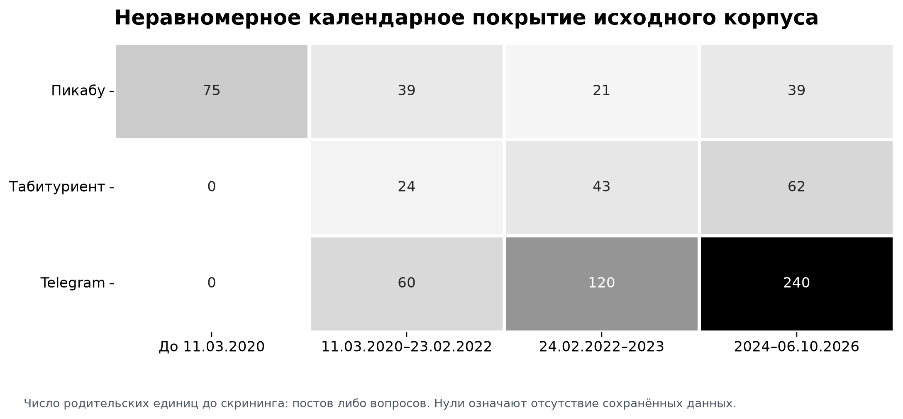

# Публичное обоснование образовательных траекторий: результаты анализа

Сопоставление официальной коммуникации, публичного консультирования и пользовательских обсуждений позволяет различить несколько способов представления образовательного выбора. В официальных сообщениях образование преимущественно обосновывается через его практическую полезность; в консультировании обсуждаются условия поступления и доступные варианты достижения цели; в личных рассказах ценность подготовки соотносится с опытом обучения и работы. Эти различия существенны для центрального вопроса исследования: означает ли положительное описание среднего профессионального образования (СПО) предложение снизить образовательные притязания или допускает другие интерпретации?

Анализ показывает, что упоминания альтернативного маршрута, поддержки ожиданий и критики диплома нельзя объединять в один механизм охлаждения. В исследованном корпусе не обнаружено случаев, удовлетворяющих принятому строгому определению охлаждения: выраженная исходная цель, предложение снизить её в связи с обозначенным препятствием и смягчающее обоснование этого пересмотра. При этом представлены советы, сохраняющие профессиональную цель при изменении программы, организации или способа финансирования. Критические суждения о высшем образовании (ВО), в свою очередь, часто ограничены достаточностью диплома для работы, качеством конкретной программы либо необходимостью отдельной ступени подготовки. Ни один из этих результатов сам по себе не устанавливает изменение реальных решений участников.

## 1. Эмпирическая база и процедура анализа

Исследование выполнено на сохранённом экспорте первого этапа сбора данных. Он содержит 1094 записи, объединённые в 723 контекстных пакета: 420 официальных постов Telegram, 174 поста Пикабу с 166 сохранёнными комментариями и 129 вопросов Табитуриента с 205 ответами. Контекстный пакет представляет собой официальный пост либо родительский пост или вопрос вместе с доступными откликами. Количественная единица анализа — отдельное сообщение определённого типа. Поэтому число записей не соответствует числу независимых участников, а несколько ответов на один вопрос не рассматриваются как несколько независимых случаев образовательного выбора.

После проверки тематической релевантности в анализ включены 773 сообщения. Исключены 306 записей, ещё для 15 содержание или контекст признаны недостаточными. В официальном корпусе включены 208 из 420 постов; на Пикабу — 134 из 174 постов и 100 из 166 комментариев; на Табитуриенте — все 129 вопросов и 202 из 205 ответов. Отбор опирался на связь текста с образовательным выбором, доступом к обучению, ценностью квалификации или обоснованием политики. Наличие охлаждения, критики ВО или положительной оценки СПО не являлось условием включения. Содержательно релевантная реклама также сохранялась, поскольку рекламная функция сообщения не устраняет его значения для анализа аргументации.

*Рисунок 1. Результаты скрининга по пяти типам сообщений. Недостаточность данных выделена отдельно от исключения по тематической нерелевантности.*

Источники различаются условиями отбора. Telegram представлен 240 постами Минобрнауки и 180 постами Минпросвещения из фиксированных окон, а не полным потоком публикаций. На Пикабу у 166 постов сохранено по одному комментарию, у восьми комментарии отсутствуют; реконструировать обсуждения по этим данным невозможно. На Табитуриенте ответы имеются для 95 из 129 вопросов. Из вопросов 122 получены посредством отбора случайных идентификаторов страниц, семь добавлены целенаправленно. Последним соответствуют 13 записей с учётом ответов. Эти способы формирования массива дают доступ к разным публичным ситуациям, но не создают репрезентативной выборки российских абитуриентов, семей или образовательных организаций.

Кодирование сочетало теоретически заданные категории и уточнение правил на пилоте. Использованы четыре семейства легитимации — ссылка на авторитет или норму, практическая польза, моральная оценка и история успеха или неудачи; механизмы охлаждения, поддержки ожиданий, сохранения цели при смене пути и информирования; признаки семейной аргументации, самоописания автора, прочтения определимого тезиса и девальвации диплома. Определения согласованы с литературным обзором и методологией [Goffman, 1952; Clark, 1960; Hall, 1980; Van Leeuwen, 2007]. Коды относятся к выраженному в тексте содержанию. Истинность обещаний трудоустройства, доступности обучения или последующего перехода в вуз по этим сообщениям не проверялась.

Первичную разметку выполнили три агента GPT-6 Luna с уровнем рассуждения medium по отдельным корпусам. Кодификатор уточнён на 24 контекстных пакетах, включавших 45 сообщений. Затем вне пилота случайно выделено по 30 пакетов каждого корпуса — всего 90 пакетов и 165 сообщений — для повторного кодирования другим агентом той же модели без доступа к первой разметке. После этого разобраны пограничные эпизоды и зарегистрированы 13 содержательных поправок. Исходные решения и исправления сохранены раздельно. Авторы перепроверили анализ и 15 октября 2026 года подтвердили сохранение полученных классификаций и аналитических решений без изменений.

Авторская проверка результатов отличается от независимого повторного кодирования. Рассчитанные показатели согласия относятся к двум модельным разметкам до согласования; они не переименованы в показатели согласия человека и модели. Проверка охватывала около 15% исходных сообщений, тогда как методологический план предусматривал иной контроль с участием исследователя. Для содержательных кодов сопоставлялись случаи, включённые обеими моделями, с попарным исключением неопределимых значений. Альфа Криппендорфа составила 0,11 для практической аргументации в Telegram, 0,53 для поддержки ожиданий и 0,49 для смены пути при сохранении цели в ответах Табитуриента, 0,01 для прочтения тезиса в комментариях Пикабу и −0,35 для этого признака в ответах Табитуриента. Эти значения указывают на неодинаковую воспроизводимость категорий. Принятие итоговых решений авторами не изменяет результаты такого контроля: частоты ниже описывают итоговую классификацию данного корпуса, а обобщения опираются также на разбор содержания и границ случаев. Независимые показатели точности относительно человеческой разметки не рассчитывались.

Для каждого типа сообщений используется собственный знаменатель. Один текст может содержать несколько аргументов или предложений, поэтому сумма долей совместимых кодов может превышать 100%. Вопросы Табитуриента читались в общем пакете с ответами с инструкцией определять тип вопроса по его собственному тексту; технического разделения этих материалов не было. Подробно рассматриваемые случаи отобраны после получения кодов, что также учитывается при оценке процедуры. Пользовательские эпизоды излагаются в перефразированном виде; идентификаторы служат для связи с аналитическими карточками, а не для раскрытия авторов.

## 2. Официальное обоснование СПО и ВО

Для ответа на ВИ1 сопоставлены общие июльские окна двух ведомств за 2022–2026 годы. В них входят 73 релевантных поста Минпросвещения и 89 постов Минобрнауки. Такой отбор сокращает различия календарного охвата, хотя сохраняет зависимость результатов от тематических квот и ведомственных задач. Рассчитанные доли характеризуют состав отобранных тематических сообщений; по ним нельзя определить место СПО или ВО во всей информационной повестке министерств.

В обоих наборах наиболее многочисленны практические обоснования. Они отмечены в 54 из 73 постов Минпросвещения (74,0%) и в 79 из 89 постов Минобрнауки (88,8%). Ссылки на авторитет и нормы представлены соответственно в семи (9,6%) и 16 сообщениях (18,0%); моральные обоснования — в шести (8,2%) и одном (1,1%); истории успеха или неудачи — в четырёх (5,5%) и двух (2,2%). В терминологии ван Левена такой профиль соответствует заметному месту рационализации: обучение получает оправдание через ожидаемый результат, полезность подготовки и возможность профессионального применения [Van Leeuwen, 2007]. Приведённые различия между ведомствами являются описательными и не рассматриваются как установленный эффект ведомственной принадлежности.

*Рисунок 2. Способы обоснования в отобранных постах Минпросвещения и Минобрнауки за общие июльские окна 2022–2026 годов. Знаменатели — 73 и 89 сообщений соответственно; категории совместимы.*

Тематический состав помогает уточнить этот результат. СПО упомянуто в 25 из 73 постов Минпросвещения (34,2%) и в четырёх из 89 постов Минобрнауки (4,5%); ВО — в 52 из 73 (71,2%) и во всех 89 сообщениях соответственно. Темы могут присутствовать совместно. Следовательно, различия аргументации возникают внутри неодинаковых тематических наборов. Более высокая доля практических обоснований в одном из них не позволяет отделить специфику ведомства от предмета сообщения, жанра и самого отбора.

Содержательно существеннее другое: оправдание полезности образовательного пути ещё не задаёт его отношения к личной цели адресата. Сообщение может представлять подготовку как доступную, востребованную или перспективную, не предлагая никому отказаться от прежде выраженного ожидания. Это согласуется с различением публичного обоснования и индивидуального перенаправления, проведённым в теоретической части [Schmidt, 2008; Goffman, 1952]. Для установления охлаждения недостаточно обнаружить положительное описание колледжа; требуется связанный эпизод пересмотра цели.

Показателен официальный случай TG0145, в котором обсуждается избыточность магистратуры для части карьерных маршрутов при достаточности базового высшего образования. Оценка относится к устройству и необходимости определённой ступени подготовки. Она позволяет увидеть ограничение универсальной ценности продолжения обучения, но не показывает отказа конкретного участника от ранее названной цели. Одновременно этот пример препятствует распространению критики отдельной ступени на всё ВО: базовая подготовка в аргументе сохраняет самостоятельное значение. Таким образом, ответ на ВИ1 заключается в описании преимущественно практического обоснования образовательных возможностей и неодинакового тематического состава ведомственных сообщений; по этим текстам не устанавливается механизм снижения притязаний аудитории.

## 3. Консультирование: поддержка ожиданий и изменение маршрута

ВИ2 требует сопоставить предложение с целью самого участника. В соответствии с Гофманом и Кларком охлаждение предполагает связь между затруднением первоначального ожидания и помощью в принятии его пересмотра [Goffman, 1952; Clark, 1960]. В данном анализе эта связь должна быть выражена текстуально. Колледж не считается более низкой целью по определению: один участник может стремиться к конкретной профессии, другой — к университетскому диплому, третий — к доступному обучению независимо от уровня. Без установления такого различия одинаковый совет получил бы одинаковую интерпретацию в принципиально разных ситуациях.

Среди 202 включённых ответов Табитуриента информирование отмечено в 135 случаях (66,8%), поддержка ожиданий — в 54 (26,7%), сохранение конечной цели при смене пути — в 32 (15,8%). Отношение предложения к выраженной цели классифицировано как её сохранение в 112 ответах. В 86 сопоставления целей нет, ещё в четырёх его результат не устанавливается. Сохранение цели и расширение маршрута здесь различаются: поддержать прежнее направление можно без предложения нового пути. Поэтому 112 ответов с сохранением цели не следует отождествлять с 32 ответами, в которых описана именно смена маршрута.

*Рисунок 3. Информирование, поддержка ожиданий и сохранение цели при смене пути в ответах Табитуриента, а также наблюдаемость отношения к исходной цели. Основание расчёта — 202 включённых ответа; механизмы могут сочетаться.*

После разбора пограничных эпизодов в итоговой классификации не осталось случаев строгого охлаждения. Рассмотрение двух близких к нему предложений показывает, почему само упоминание СПО недостаточно. В пакете TB0071 родитель сообщает о низких экзаменационных результатах и спрашивает о возможностях поступления; в ответе TB0074 предложены колледж либо пересдача экзамена. Здесь присутствуют препятствие и варианты дальнейшего действия, однако исходная цель именно высшего образования не названа. Кроме того, сожаление по поводу ограничения не тождественно обоснованию, которое помогает принять снижение цели. Классификация такого ответа как охлаждения потребовала бы приписать участнику отсутствующее в тексте намерение.

В пакете TB0224–TB0225 исходная цель определённее: речь идёт об университетской подготовке для работы с данными. В ответ предложен аграрный техникум, но связь этого предложения с препятствием не объясняется; нет и смягчающего обоснования. Возможная ирония дополнительно ограничивает однозначное прочтение. Этот эпизод содержит заметное расхождение между запросом и советом, однако не образует полной конструкции охлаждения. Оба случая важны именно как границы понятия: не всякое ограничение возможностей сопровождается снижением цели, и не всякое несоответствующее запросу предложение объясняет принятие нового статуса.

Иное отношение между целью и маршрутом представлено в пакете TB0289. В ответе TB0294 предложены смежные технические направления, целевой приём и дополнительная подготовка при сохранении профессиональной перспективы в IT. Обсуждаются способы достижения желаемого результата с учётом возможностей поступления и финансирования. Этот случай соответствует рабочей категории расширения маршрута и близок к различению сохранения притязаний и изменения пути у Войер и Лунд [Voyer, Lund, 2026]. Вместе с тем обещания карьерной помощи и доступности обучения остаются свойствами совета: данные не показывают, воспользовался ли ими адресат и насколько они выполнимы.

Состав запросов уточняет контекст консультирования. На процедурные вопросы приходятся 111 включённых ответов, на смешанные, соединяющие процедуру и препятствия, — 91. Альтернативы представлены в 60 из 111 ответов первой группы (54,1%) и в 65 из 91 второй (71,4%). Информирование отмечено соответственно в 83 (74,8%) и 52 ответах (57,1%), сохранение цели при смене пути — в 12 (10,8%) и 20 (22,0%). В пределах классификации более сложный запрос чаще сопровождается обсуждением вариантов пути. Однако зависимость ответов внутри одного вопроса, неодинаковое содержание запросов и описанная процедура их чтения не позволяют трактовать это распределение как самостоятельный эффект типа вопроса.

Семь ответов имеют исходную метку принадлежности к университету или приёмной комиссии; они относятся к двум организациям. Независимого подтверждения авторства нет, а объём материала недостаточен для сравнения организационных стратегий. Ответ на ВИ2 поэтому относится к публичным предложениям: в них различимы информирование, поддержка ожиданий и изменение маршрута при сохранении цели, тогда как полная текстовая конструкция охлаждения не выявлена. Этот результат не исключает существования механизма в других сообщениях или в более длительном консультировании, отсутствующем в сохранённом контексте.

## 4. Семейный опыт и возможности анализа прочтений

ВИ3 связывает оценки образовательных путей с самоописаниями и семейным опытом. Литература позволяет ожидать различий между значением одного маршрута для семей с неодинаковыми ресурсами и образовательной историей [Breen, Goldthorpe, 1997; Хавенсон, Чиркина, 2018]. Однако для анализа конкретных сообщений эти характеристики должны быть выражены самим автором. Текст о ребёнке не обязательно написан родителем, а история выпускника не обязательно является автобиографической. Поэтому отдельно учитывались семейный опыт как аргумент, прямо названная роль автора и возможность определить его прочтение конкретного тезиса.

Семейный опыт используется в аргументации в 26 из 134 постов Пикабу (19,4%), трёх из 100 комментариев (3,0%) и двух из 208 официальных постов (1,0%). В вопросах и ответах Табитуриента этот признак не выделен. Результат относится к функции опыта в обосновании, а не к присутствию родителей на площадке. Родитель может задать процедурный вопрос, не используя семейную историю как довод; официальный текст, напротив, может включать такой довод через рассказ о других людях, не становясь самоописанием его издателя.

Прямая информация о роли автора имеется в 95 постах Пикабу (70,9%) и 16 комментариях (16,0%), в 43 вопросах Табитуриента (33,3%) и 17 ответах (8,4%). Различия согласуются с возможностями жанра: развёрнутый рассказ чаще содержит биографическое представление, чем короткий отклик или практический совет. Они не позволяют сравнивать доли родителей, абитуриентов или выпускников среди всех пользователей этих площадок. Ограничение особенно заметно в случае PK0009: история о расхождении личных намерений и семейных ожиданий обозначена как перепечатка, поэтому биография героя не переносится на автора публикации.

*Рисунок 4. Семейный опыт как аргумент, прямо названная роль автора и возможность классифицировать прочтение определимого тезиса. Доли рассчитаны внутри каждого типа сообщений. Третья панель объединяет принятие, принятие с оговорками и оспаривание; она не показывает долю согласия.*

Образование родителя прямо установлено лишь в одном из 773 включённых сообщений; в остальных 772 оно неизвестно. Сравнение родителей с высшим образованием и без него на этом материале невозможно. Единственный доступный случай PK0181, однако, имеет самостоятельное аналитическое значение. Автор прямо сообщает о родительстве и полученном ВО, после чего описывает выбор ремесленной подготовки как освоение новой практической деятельности. СПО здесь выступает дополнительным профессиональным развитием. В тексте не описано внешнее предложение снизить прежде выраженную образовательную цель; выбор новой подготовки представлен как собственное решение автора. Этот эпизод согласуется с вниманием к неоднородности решений о колледже в российских исследованиях, но не определяет распространённости подобной траектории [Мальцева, Сальникова, Шабалин, 2022; Павленко, 2023].

Прочтение устанавливаемого тезиса классифицировано в 78 из 100 комментариев Пикабу, семи из 134 постов и трёх из 202 ответов Табитуриента. В логике Холла этот признак обозначает возможность соотнести высказывание с конкретным утверждением, а не положительность отношения к нему [Hall, 1980]. Число 78 объединяет принятие, принятие с оговорками и оспаривание. Исходный тезис может принадлежать участнику обсуждения; его наличие не превращает отклик в реакцию на государственную политику. Поэтому материал позволяет рассматривать способы обращения с определимыми утверждениями, но не оценивать долю поддержки официальной позиции.

Ответ на ВИ3 ограничен доступностью самоописаний. Семейный опыт наиболее заметен как ресурс аргументации в развёрнутых пользовательских рассказах, где автор связывает оценку образования с биографической ситуацией. При этом данных об образовании родителей практически нет, а связь большинства высказываний с конкретным государственным сообщением не установлена. Теоретическое ожидание зависимости прочтения от семейного статуса остаётся важным для постановки вопроса, но не получает здесь самостоятельной эмпирической проверки.

## 5. Девальвация диплома и границы критики образования

ВИ4 обращён к тому, чем обосновывается снижение ценности диплома. В итоговой классификации этот признак выделен в девяти сообщениях: пяти постах Пикабу, трёх ответах Табитуриента и одном официальном посте. В него не включались простое сообщение о работе не по специальности, сравнение заработков или критика процедуры, если отсутствовала оценка ценности диплома ВО. Такой отбор позволяет различить сведения о профессиональном пути и суждение о том, что даёт или перестаёт давать образовательный документ.

В восьми из девяти сообщений основание оценки связано с трудоустройством, в семи — с символическим статусом, в шести — с навыками и знаниями, в четырёх — с качеством обучения, в трёх — с доходом и ещё в трёх — с избытком дипломированных выпускников. Основания сочетаются в одном сообщении, поэтому их сумма больше девяти. Этот профиль описывает структуру небольшого набора оценочных высказываний. Он не устанавливает иерархию причин девальвации образования в обществе.

*Рисунок 5. Основания оценок снижения ценности диплома ВО в девяти выделенных сообщениях. Категории совместимы; единица подсчёта — сообщение, содержащее соответствующее основание.*

Разбор случаев обнаруживает несколько разных предметов критики. В PK0072 диплом сохраняет значение для формального доступа к работе, но его недостаточность объясняется отсутствием практического опыта. Здесь оспаривается автоматическая связь документа с профессиональной готовностью. Такое суждение допускает сохранение институциональной ценности диплома одновременно с критикой его содержательной достаточности. Этот случай показывает, почему в анализе важно разделять формальную и содержательную ценность квалификации.

В PK0091 противопоставлены реальные умения и формальные документы, а собственный опыт служит основанием предпочтения практического освоения работы. Критика затрагивает разные уровни подготовки; её нельзя свести к повышению ценности СПО за счёт ВО. В PK0285 результат обучения связывается с самостоятельными усилиями при критике преподавания и формального освоения программы. Документ не признаётся гарантией компетентности, но потребность в профессиональных знаниях сохраняется. Смысл этих высказываний состоит в пересмотре того, что должно подтверждать образование, а не обязательно в отказе от самой подготовки.

Другие случаи ограничены программой или ступенью. Ответ TB0105 касается навыков и востребованности выпускников конкретной университетской программы; TB0246 — перспектив лингвистической подготовки и соотношения знаний с дипломом. В обоих эпизодах критическая оценка не сопровождается установленным предложением снизить образовательную цель адресата. Официальный TG0145, рассмотренный выше, ограничивает необходимость магистратуры для части карьерных путей при сохранении значения базового ВО. Объединение этих сообщений под общим признаком девальвации полезно для отбора случаев, однако содержание признака требует различать масштаб утверждения.

Таким образом, критика диплома в корпусе неоднородна. Она может относиться к недостаточности документа без опыта, к расхождению программы с практикой, к символическому статусу или к избыточности дополнительной ступени. Эта неоднородность согласуется с выводом литературного обзора о необходимости различать изменение символической ценности образования и исчезновение его преимуществ [Константиновский, Попова, 2020; Чередниченко, 2020]. Сохранение ценности знаний при сомнении в дипломе делает интерпретацию через единый отказ от ВО слишком широкой. При этом отсутствие ссылки на государство в личном рассказе не доказывает независимого происхождения аргумента: траектории его распространения по этим данным не восстановлены.

## 6. Различия между коммуникативными ситуациями

Для ответа на ВИ5 выделены сообщения общей темы СПО/ВО за 24 февраля 2022 — 6 октября 2026 года. Сравниваемый набор включает 181 официальный пост, 44 поста и 24 комментария Пикабу, 104 вопроса и 177 ответов Табитуриента. Типы сообщений сохранены раздельно: объединение вопросов с ответами либо постов с комментариями скрыло бы различие между запросом, предложением и оценочным откликом. Общая тема и период делают сравнение более определённым, но не устраняют особенностей площадок и отбора.

Практические обоснования отмечены в 145 из 181 официального поста (80,1%), 26 из 44 постов Пикабу (59,1%), восьми из 24 комментариев (33,3%) и 75 из 177 ответов Табитуриента (42,4%). Истории успеха или неудачи представлены соответственно в семи официальных постах (3,9%), 20 постах Пикабу (45,5%), двух комментариях (8,3%) и 16 ответах (9,0%). В вопросах Табитуриента метки четырёх семейств легитимации отсутствуют. Это показывает прежде всего различие задач сообщения: запрос о возможностях ещё не является самостоятельным оправданием образовательного пути.

*Рисунок 6. Профили способов обоснования в сообщениях общей темы СПО/ВО за 24.02.2022–06.10.2026. Каждый тип сообщений имеет отдельный знаменатель; совпадение периода не устраняет различий жанра и отбора.*

Содержательное сравнение позволяет выделить разное использование близких аргументов. В официальной коммуникации полезность образования описывает оправданность предлагаемого направления; в консультировании та же категория связывается с доступным решением конкретного затруднения; в биографическом рассказе полезность оценивается через сопоставление обещаний с пережитым результатом. История опыта может одновременно поддерживать значение подготовки и ограничивать доверие к формальному диплому. Поэтому общая ориентация на трудоустройство не задаёт единства позиций: участники могут пользоваться сходным критерием, но по-разному оценивать соответствие ему образовательного пути.

Эта интерпретация соответствует разграничению публичного обоснования и прочтений, предложенному в литературном обзоре [Schmidt, 2008; Hall, 1980]. Результаты позволяют сопоставить задачи аргумента в разных ситуациях, но не выстроить цепочку передачи от ведомства к организации и далее к семье. Совпадение темы или довода не подтверждает заимствования; различие частот не устанавливает влияние площадки. Для такого вывода потребовались бы документированные связи сообщений и более сопоставимые условия наблюдения.

## 7. Обсуждение результатов

Центральное аналитическое различие проходит между обоснованием ценности маршрута и пересмотром цели конкретного участника. В официальных постах практическая полезность делает образовательный путь оправданным в общем виде. В консультировании эта полезность соотносится с условиями поступления, доступными программами и профессиональной перспективой. Только наличие выраженной цели позволяет установить, поддерживает ли совет прежнее ожидание, предлагает другой способ его реализации или означает снижение. Сохранённые случаи показывают продуктивность такого разграничения: предложение колледжа без названной исходной цели, необъяснённый совет другой организации и смена финансирования при сохранении профессии имеют разные значения.

Отсутствие полного сочетания признаков охлаждения уточняет границы применимости исходной исследовательской рамки. Оно не позволяет интерпретировать всякое положительное представление СПО как работу по примирению с образовательной неудачей. Для ряда эпизодов более подходящими оказываются категории информирования и расширения маршрута. Вместе с тем поддержка ожиданий не доказывает благоприятных последствий совета: как показывает обсуждаемая в обзоре работа Дейл-Амен и Розенбаума, сохранение надежды может иметь сложные организационные последствия [Deil-Amen, Rosenbaum, 2002]. В настоящем исследовании наблюдаются предложения, а их осуществление и дальнейшие решения участников остаются за пределами материала.

Второе различие касается отношения к образованию и отношения к диплому. Критика документа может сочетаться с признанием необходимости знаний, практики и формального доступа к профессии. В таких случаях спор касается достаточности имеющегося подтверждения квалификации. Это объясняет, почему девальвация отдельной программы или ступени не означает автоматического предпочтения СПО и не доказывает снижения притязаний. Для понимания оценки необходимо установить её предмет: уровень, программу, навыки, карьерное обещание или символический статус.

Третье различие связано с возможностью наблюдать опыт аудитории. Пользовательские рассказы дают больше материала о семейной и профессиональной биографии, но почти не позволяют сравнить образовательный статус родителей. Комментарий чаще связан с определимым тезисом, однако этот тезис не обязательно является государственным. Поэтому семейный опыт и прочтение официальной коммуникации не образуют в данных готовой причинной связи. Вклад исследования состоит в установлении доступных форм аргументации и условий их интерпретации, а также в выявлении случаев, не укладывающихся в однозначную иерархию «вуз — колледж».

## 8. Устойчивость результатов и границы вывода

Общая временная рамка исследования — 1 января 2018 — 6 октября 2026 года. Она разделена на четыре периода: до 11 марта 2020 года, 11 марта 2020 — 23 февраля 2022 года, 24 февраля 2022 — 31 декабря 2023 года и 1 января 2024 — 6 октября 2026 года. Доковидный материал представлен только Пикабу. Для периодного описания Пикабу два последних интервала объединены по принятому правилу доступности материала: в третьем имеются лишь 15 включённых родительских постов. В других корпусах такого объединения не потребовалось. Неравная продолжительность интервалов и неодинаковое покрытие исключают чтение их частот как динамики общественного мнения.

*Рисунок 7. Календарное покрытие корпуса до скрининга. Пустая ячейка означает отсутствие записей в сохранённом экспорте, а не отсутствие темы в публичной коммуникации.*

Проверки чувствительности оценивали зависимость результата от состава массива. Каждый вариант рассчитывался отдельно относительно основного набора из 773 сообщений. При исключении дополнительных точных повторов остаются 767 включённых сообщений, близких повторов — 763, целенаправленно отобранных вопросов и связанных ответов — 760. Ограничение Telegram июльскими окнами оставляет 749 сообщений во всём анализируемом наборе; исключение отмеченных неоднозначных случаев — 742. Во всех этих вариантах сохраняются нулевое число строгих случаев охлаждения и девять сообщений с девальвацией диплома. Точные повторы определялись по подготовленному содержанию внутри источника и типа сообщения; близкие — по символьному сходству с порогом косинусной меры 0,92 для текстов длиной не менее 100 символов. Эти проверки показывают устойчивость двух итоговых подсчётов к данным исключениям, но не измеряют чувствительность смысловой классификации к пропущенным случаям.

Основные ограничения вытекают из характера наблюдения. Квотный и тематический сбор не позволяет переносить доли на население или полный поток публикаций. Неполные обсуждения ограничивают восстановление целей и последовательности взаимодействия. Почти полное отсутствие сведений об образовании родителей исключает проверку связанных с ним различий. Малое число ответов с организационной меткой не даёт основания сравнивать приёмные комиссии, а отсутствие наблюдения за дальнейшими действиями участников не позволяет оценивать фактическую смену притязаний. Близость сообщения к реформе по дате также не доказывает реакции на неё. Доверительные интервалы и тесты значимости не применялись; различия трактуются как характеристики исследованного корпуса.

В этих границах результаты отвечают на поставленные вопросы. Официальные тексты раскрывают преимущественно практические способы обоснования образовательных возможностей; консультирование различает сохранение цели и изменение пути; семейные рассказы показывают контекст оценки, но не распределение позиций по социальным группам; критика диплома имеет несколько предметов и не сводится к отказу от ВО. Межкорпусное сопоставление выявляет различия функций аргумента без доказательства его передачи или воздействия. Рассмотренные случаи тем самым позволяют конкретизировать, при каких условиях разговор о привлекательности СПО и ограничениях ВО относится к поддержке и переустройству образовательного пути, а при каких данных вопрос об охлаждении остаётся неустановленным.
