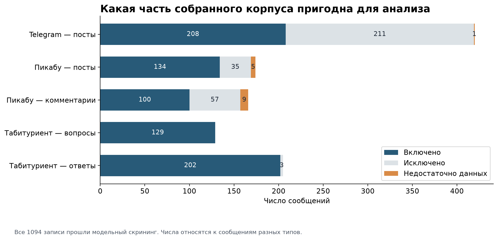
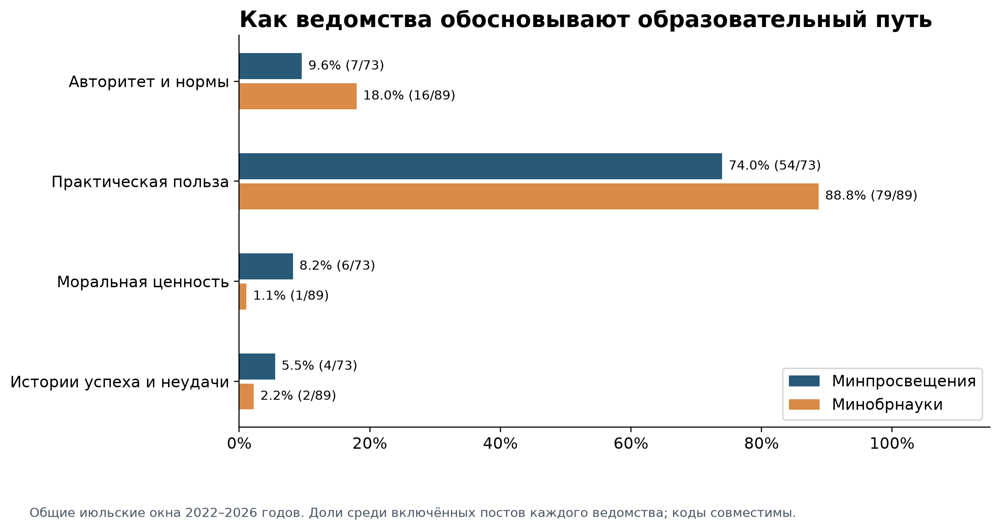
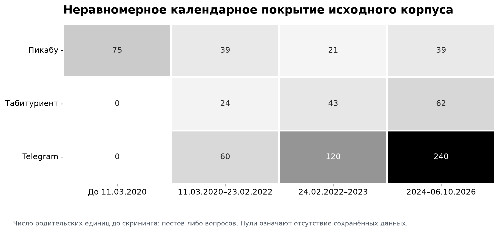

# Рисунки для вставки в документ

Копии PNG из [analysis_preprint_2026-10-15/figures](../analysis_preprint_2026-10-15/figures) (оттуда же можно взять SVG). Номер в имени файла совпадает с номером рисунка: рисунки идут в одном порядке и в [FINAL_FULL_TEXT.md](../FINAL_FULL_TEXT.md) (часть III), и в [FINAL_PAPER.md](../FINAL_PAPER.md). Подписи в двух текстах немного различаются, ниже приведены обе.

## Рисунок 1

Файл: `figure_01_screening.png`

- Полная версия: Рисунок 1. Скрининг по типам сообщений. Недостаточность данных отделена от тематической нерелевантности.
- Статья: Рисунок 1. Результаты скрининга по пяти типам сообщений.

## Рисунок 2

Файл: `figure_02_official_arguments.png`

- Полная версия: Рисунок 2. Способы обоснования в общих июльских окнах 2022–2026 годов. Знаменатели — 73 и 89 постов; категории совместимы.
- Статья: Рисунок 2. Способы обоснования в постах двух министерств за общие июльские окна 2022–2026 годов; категории совместимы.

## Рисунок 3

Файл: `figure_03_advice_mechanisms.png`

- Полная версия: Рисунок 3. Механизмы и отношение к исходной цели в 202 ответах Табитуриента. Механизмы могут сочетаться.
- Статья: Рисунок 3. Механизмы консультирования в 202 ответах Табитуриента и наблюдаемость отношения к исходной цели; механизмы могут сочетаться.

## Рисунок 4

Файл: `figure_04_family_observability.png`

- Полная версия: Рисунок 4. Семейный аргумент, самоописание роли и классификация прочтения тезиса. Третья панель объединяет все типы прочтения, а не долю согласия.
- Статья: Рисунок 4. Семейный опыт как аргумент, названная роль автора и возможность классифицировать прочтение тезиса по типам сообщений.

## Рисунок 5

Файл: `figure_05_devaluation_bases.png`

- Полная версия: Рисунок 5. Основания оценок девальвации диплома в девяти сообщениях. Один текст может содержать несколько оснований.
- Статья: Рисунок 5. Основания оценок снижения ценности диплома ВО в девяти сообщениях; категории совместимы.

## Рисунок 6

Файл: `figure_06_cross_corpus.png`

- Полная версия: Рисунок 6. Способы обоснования в общей теме и периоде. Каждый тип сообщений имеет собственный знаменатель.
- Статья: Рисунок 6. Профили способов обоснования в сообщениях общей темы СПО/ВО за 24.02.2022–06.10.2026; у каждого типа сообщений свой знаменатель.

## Рисунок 7

Файл: `figure_07_calendar_coverage.png`

- Полная версия: Рисунок 7. Покрытие до скрининга. Пустая ячейка означает отсутствие записей в экспорте, а не отсутствие темы.
- Статья: Рисунок 7. Календарное покрытие корпуса до скрининга; пустая ячейка означает отсутствие записей в экспорте, а не отсутствие темы.
